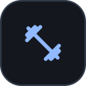
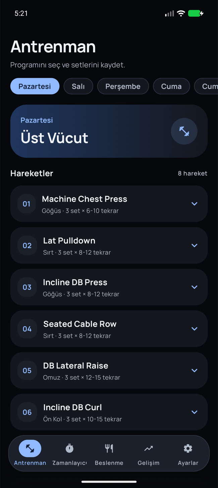
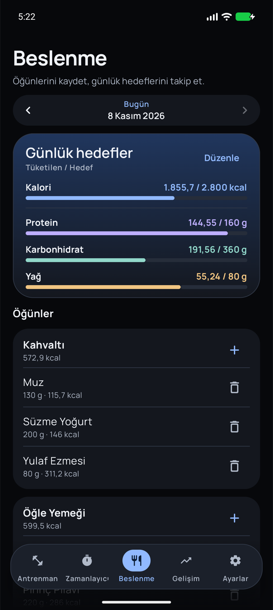
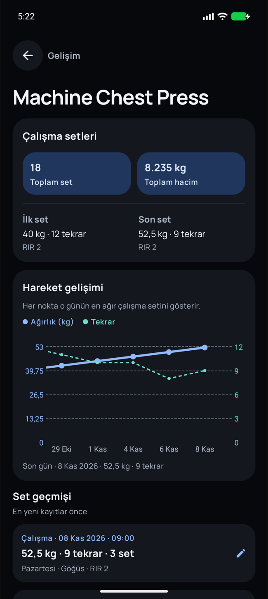

<p align="center">
  
</p>

<h1 align="center">Gimmer</h1>

<p align="center"><a href="README.md">Türkçe</a> · <strong>English</strong></p>

<p align="center">
  A workout and nutrition log for Android.
</p>

<p align="center">
  
  
  
  <a href="LICENSE"></a>
</p>

Gimmer is a Turkish-language Android app for hypertrophy training. Log sets quickly, track progress for each exercise, record nutrition and sleep, and back up your data to Google Drive.

## Screenshots

<p align="center">
  
  
  
</p>

<p align="center"><sub>Workout · Nutrition · Exercise progress</sub></p>

## What you can do with Gimmer

### In the gym

- Open an exercise to prefill the weight and reps from your last logged set for that exercise. Use the large plus and minus buttons to adjust weight in 2.5 kg steps and reps one at a time.
- Log warm-up and working sets separately. Record reps in reserve (RIR) and add a note to any set.
- In the built-in routine, saving the first working set of an **A1/A2 pair** opens the partner exercise. After A2, the timer uses the longer rest duration in the pair. Individual compound lifts use **180 seconds** and isolation exercises use **90 seconds**. You can also start a timer manually.
- See which plates to load on each side of a standard **20 kg bar**. If the exact target is unavailable, the calculator shows the closest load at or below it.

### Nutrition and progress

- Log meals by weight and follow daily calorie, protein, carbohydrate, and fat targets. Look up products by name or barcode through Open Food Facts, or enter foods manually.
- Review training days on a monthly calendar and chart your progress exercise by exercise. Each data point represents the heaviest working set of the day. Tap it to see the date, weight, and reps.
- Track body weight over time. Log 4–10 hours of sleep in half-hour increments under **Gelişim → Günlük Durum** (Progress → Daily Status).
- Add dated photos under **Gelişim → Görsel gelişimi yönet** (Progress → Manage Photo Progress). Browse by month or pinch to zoom in the full-screen viewer. Open the journal with biometric authentication or your device screen lock. Drive backups include the photos and their dates.

### Routine editing, export, and backup

| Task | How to do it |
| --- | --- |
| **Edit your workout routine** | Copy the current routine as JSON under **Ayarlar → Antrenman programı** (Settings → Workout Routine). Import the edited JSON, preview the training days, and confirm. The new routine replaces the active one and preserves your set history. [JSON format and example](docs/program-json.en.md) |
| **Download your records** | Open **Ayarlar → Veri aktarımı → JSON dosyasını indir** (Settings → Data Export → Download JSON File) to save a copy of your workout, nutrition, body weight, and sleep records, along with your custom routine. |
| **Back up to Drive or restore a backup** | Open **Ayarlar → Bulut yedeği** (Settings → Cloud Backup) to back up manually or choose an interval of 1 hour, 6 hours, 24 hours, or 7 days. Android runs scheduled work when background conditions allow. You can restore from any of the five most recent versions for each installation. [Drive setup guide](PREMIUM_SETUP.en.md) |

Workout, meal, and measurement records are stored on your device. Product lookup and Drive backups require an internet connection.

## Getting started

Open the project in Android Studio and sync Gradle with **Android SDK 36.1** and **JDK 21**. Run the app on a device or emulator with Android 9 or later.

```bash
git clone https://github.com/mahmutconger/Gimmer.git
cd Gimmer
./gradlew :app:assembleDebug
```

The debug APK is generated at `app/build/outputs/apk/debug/app-debug.apk`.

### Google Drive

Drive backups require Google Play services, an enabled Drive API, and an Android OAuth client that matches the APK's signing certificate. [Drive setup guide](PREMIUM_SETUP.en.md)

### Tests

```bash
./gradlew :app:testDebugUnitTest
./gradlew :app:connectedDebugAndroidTest
```

Instrumented tests require a running emulator or a connected Android device.

## Built with

Kotlin, Jetpack Compose, and Material 3 power the UI. Room stores local data, WorkManager schedules automatic backups, and Vico renders charts. Retrofit connects to the food catalog. [Open Food Facts API](https://openfoodfacts.github.io/documentation/docs/Product-Opener/api/)

## Contributing

Create a branch for your change and open a pull request against `main`. The contribution guide covers scope, testing, and review. [Contribution guide](CONTRIBUTING.en.md) · [Pull request template](.github/pull_request_template.md)

## License

Gimmer's source code is released under the MIT License. The Manrope font and the AndroidX icon are covered by their own licenses. Open Food Facts provides the food catalog under its data licenses. [MIT License](LICENSE) · [Manrope font license](app/src/main/assets/licenses/manrope.txt) · [AndroidX icon license](app/src/main/assets/licenses/apache-2.0.txt) · [Open Food Facts data licenses](https://openfoodfacts.github.io/documentation/docs/Product-Opener/api/tutorials/license-be-on-the-legal-side/)
