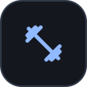
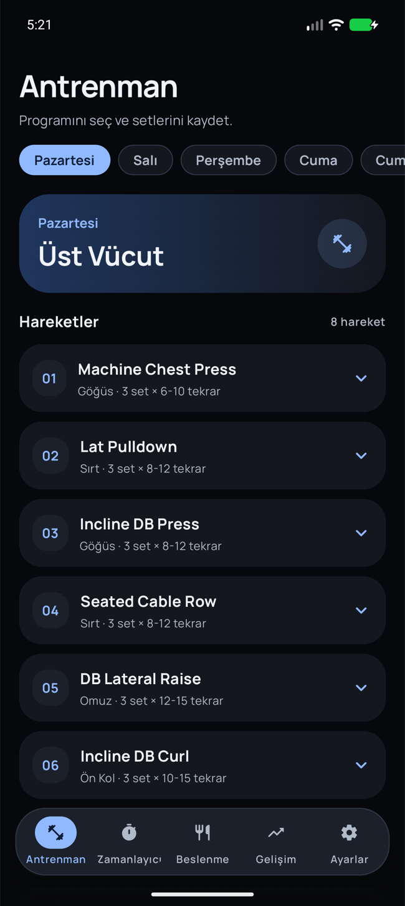
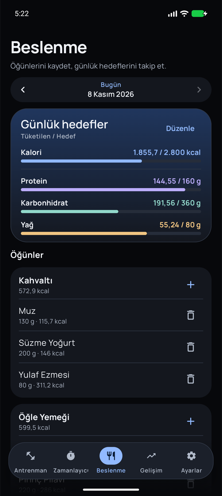
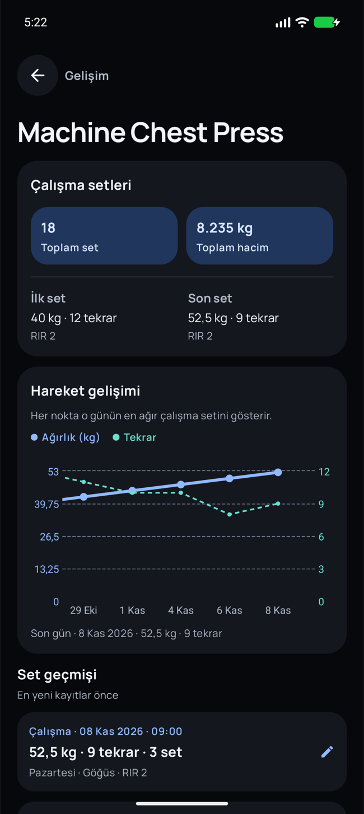

<p align="center">
  
</p>

<h1 align="center">Gimmer</h1>

<p align="center"><strong>Türkçe</strong> · <a href="README.en.md">English</a></p>

<p align="center">
  Android için antrenman ve beslenme günlüğü.
</p>

<p align="center">
  
  
  
  <a href="LICENSE"></a>
</p>

Gimmer, kas geliştirme antrenmanlarını, öğünlerini ve toparlanma kayıtlarını bir arada tutan Türkçe bir Android uygulamasıdır. Salonda önceki ağırlığını aramak yerine son set değerleriyle başlayabilir, zaman içinde hangi hareketlerde ilerlediğini görebilirsin.

## Ekranlar

<p align="center">
  
  
  
</p>

<p align="center"><sub>Antrenman · Beslenme · Hareket gelişimi</sub></p>

## Gimmer neler sağlar?

### Antrenman sırasında

- Bir hareketi açtığında **son setin ağırlığı ve tekrar sayısı** gelir. Büyük artı ve eksi düğmeleriyle ağırlığı 2,5 kg, tekrarı 1 adım değiştir.
- Isınma ve çalışma setlerini ayrı kaydet. Her sete **RIR** (yedekte kalan tekrar) ve isteğe bağlı not ekleyebilirsin.
- Set kaydından sonra dinlenme sayacı bileşik hareketlerde **180 saniye**, izole hareketlerde **90 saniye** başlar. Zamanlayıcıyı elle de kullanabilirsin.
- Bar hareketinde plaka hesaplayıcıyı aç. **20 kg barın** her tarafına takılacak plakaları gör. Hedef tam yüklenemediğinde, hesaplayıcı hedefi aşmayan en yakın ağırlığı gösterir.

### Beslenme ve gelişim takibi

- Öğünlerini gram olarak kaydet ve günlük kalori, protein, karbonhidrat ve yağ hedeflerini takip et. Open Food Facts üzerinden ürün adı veya barkodla arayabilir ya da besini elle girebilirsin.
- Antrenman günlerini aylık takvimden incele. Hareket grafiğindeki her nokta o günün en ağır çalışma setini gösterir. Bir noktaya dokunarak tarihi, ağırlığı ve tekrar sayısını birlikte görebilirsin.
- Vücut ağırlığı geçmişini takip et. **Gelişim → Günlük Durum** bölümünde gece uykunu 4–10 saat arasında, yarım saatlik adımlarla kaydet.

### Programı düzenleme ve kayıtları taşıma

| İşlem | Nereden yapılır? |
| --- | --- |
| **Antrenman programını değiştir** | **Ayarlar → Antrenman programı** bölümünden programı JSON olarak kopyala. Düzenlediğin metni içe aktar, önizle ve onayla. Bu işlem etkin programı değiştirir ve kayıtlı set geçmişini korur. [JSON biçimi ve örnek](docs/program-json.md) |
| **Kayıtlarının bir dosya kopyasını al** | **Ayarlar → Veri aktarımı → JSON dosyasını indir** ile antrenman, beslenme, vücut ağırlığı ve uyku kayıtlarını kaydet. Özel programın da dosyaya eklenir. |
| **Drive’a yedekle veya geri yükle** | **Ayarlar → Bulut yedeği** bölümünden elle yedekle ya da 1 saat, 6 saat, 24 saat veya 7 gün aralığı seç. Android, arka plan koşulları uygun olduğunda otomatik işi çalıştırır. Her kurulumun son beş yedek sürümünden birini seçebilirsin. [Drive kurulum rehberi](PREMIUM_SETUP.md) |

Antrenman, öğün ve ölçüm kayıtları cihazda saklanır. Çevrimiçi ürün araması ile Drive yedeklemesi bağlantı gerektirir.

## Kurulum

Android Studio’da projeyi açıp **Android SDK 36.1** ve **JDK 21** ile Gradle senkronizasyonunu tamamla. Uygulamayı Android 9 veya üzeri bir cihazda ya da emülatörde çalıştırabilirsin.

```bash
git clone https://github.com/mahmutconger/Gimmer.git
cd Gimmer
./gradlew :app:assembleDebug
```

Debug APK, `app/build/outputs/apk/debug/app-debug.apk` konumunda oluşturulur.

### Google Drive

Drive yedeklemesi için Google Play Hizmetleri, etkinleştirilmiş Drive API ve APK’nın imzasıyla eşleşen bir Android OAuth istemcisi gerekir. Yapılandırma adımları için [Drive kurulum rehberine](PREMIUM_SETUP.md) bak.

### Testler

```bash
./gradlew :app:testDebugUnitTest
./gradlew :app:connectedDebugAndroidTest
```

Cihaz testleri için çalışan bir emülatör veya bağlı Android cihaz gerekir.

## Altyapı

Arayüz Kotlin, Jetpack Compose ve Material 3 ile geliştirildi. Room yerel kayıtları, WorkManager otomatik yedeklemeyi, Vico grafikleri yönetir. Besin kataloğuna Retrofit ile erişilir. [Open Food Facts API](https://openfoodfacts.github.io/documentation/docs/Product-Opener/api/)

## Katkıda bulunma

Değişikliği ayrı bir dalda hazırla ve `main` dalına bir PR aç. Kapsam, test ve inceleme beklentileri [katkı rehberinde](CONTRIBUTING.md) yer alır. [PR şablonu](.github/pull_request_template.md)

## Lisans

Gimmer’ın kaynak kodu [MIT Lisansı](LICENSE) ile yayımlanır. [Manrope yazı tipi](app/src/main/assets/licenses/manrope.txt) ve [AndroidX simgesi](app/src/main/assets/licenses/apache-2.0.txt) kendi lisanslarına tabidir. Besin kataloğu Open Food Facts tarafından sağlanır. [Open Food Facts veri lisansları](https://openfoodfacts.github.io/documentation/docs/Product-Opener/api/tutorials/license-be-on-the-legal-side/)
